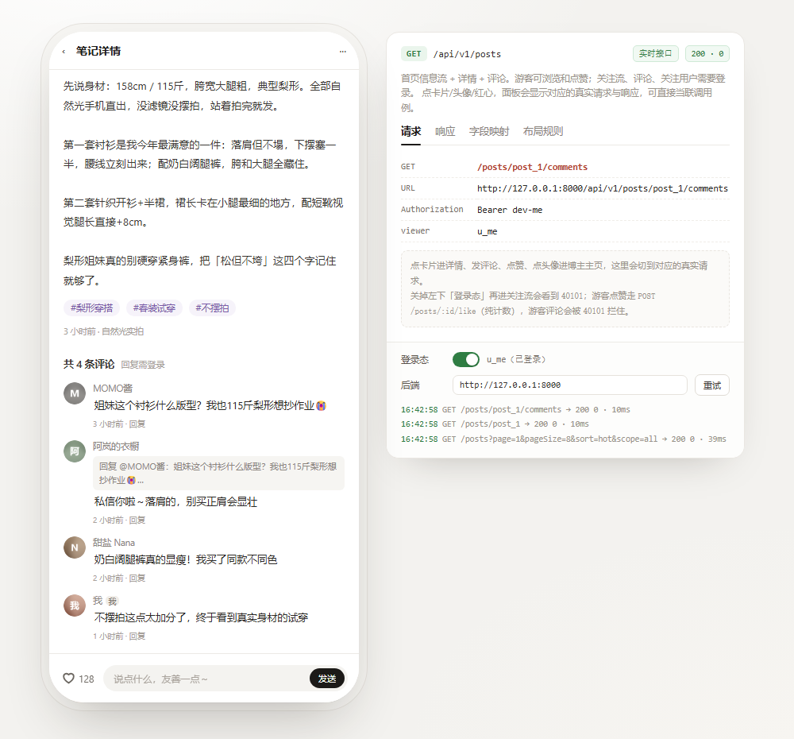
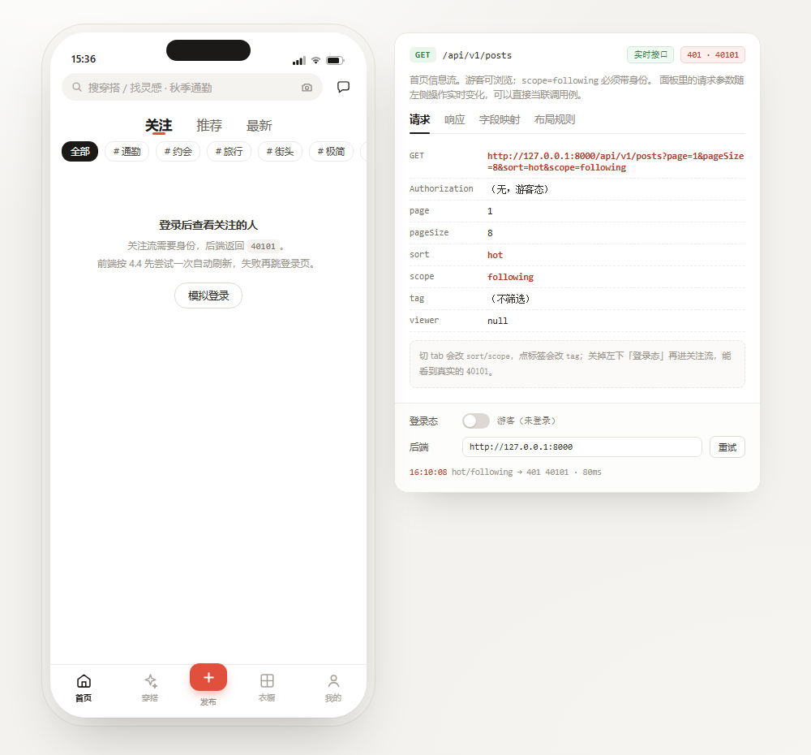
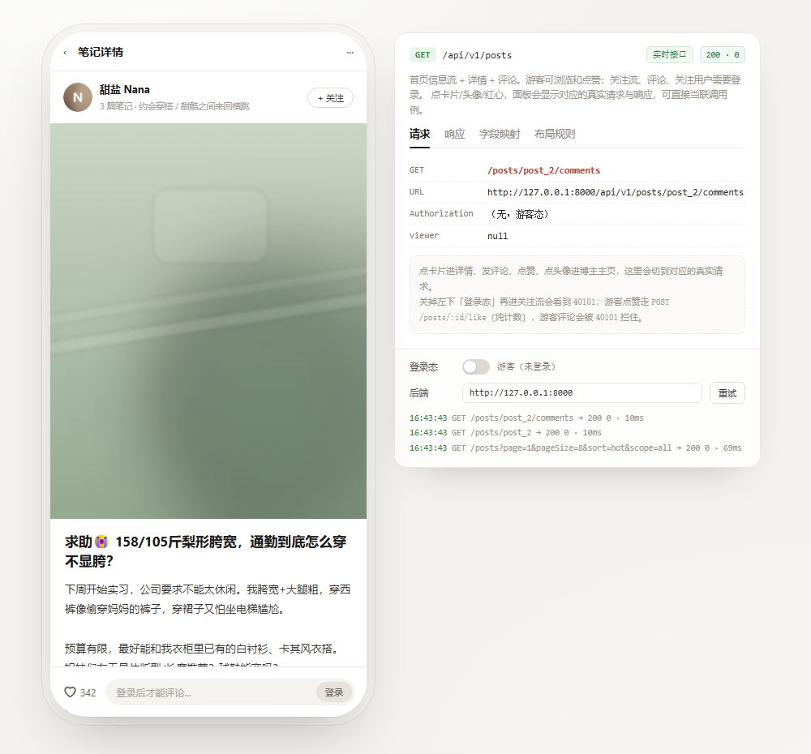

# 「我的衣橱」首页信息流 · 设计方案（后端视角）

> **一句话**：首页是打开网站看到的第一屏 —— 小红书式的响应式多列瀑布流（宽屏 4 列 / 中屏 3 列 / 窄屏 2 列），内容来自不同博主发布的穿搭推荐帖和个人求助帖。帖子能点进详情，游客也能点赞，评论必须登录。后端围绕 `GET /api/v1/posts` 列表接口，用 `sort` / `scope` / `tag` 撑起「推荐 / 最新 / 关注 / 话题」四种视图，再用详情、评论、点赞、关注四组接口把社区闭环补齐。
>
> **口径来源**：《开发对齐文档》5.1（首页信息流 → `/posts`、`/posts/:id`、`/posts/:id/like`、`/search`、`/users/:id/follow`）、5.4（社区接口，含 `/posts/:id/bookmark`）、4.1/4.2（响应外壳与错误码）、4.3（公共工程约定与统一认证）、3.5/3.6/3.7/3.8（posts、comments、likes、favorites、follows、notifications）。凡是与文档不一致的地方，本文都单独列在 **§4.4 增补清单**，按 0.1 的约定先报备再实现。

---

## 页面形态：Web 网站（非 App）

原型 `preview/index.html` 是**浏览器里直接打开的网站**，不是手机壳里的 App 模拟：

| 区域 | 说明 |
|---|---|
| 顶部固定导航栏 | Logo、导航（发现/穿搭/发布/衣橱/我的）、搜索框、登录态开关，滚动时保持可见 |
| 分类与标签 | 关注/推荐/最新 tab + 话题标签行，`sticky` 吸在顶栏下方 |
| 瀑布流 | 响应式 4/3/2 列（按容器宽度），卡片含封面、标题角标、作者、点赞；滑到底自动加载下一页 |
| 详情 | 点击卡片弹出**居中模态**：左侧大图、右侧正文与评论区，点遮罩或按 Esc 关闭 |
| 博主主页 | 点头像弹出居中模态，展示资料与 TA 的笔记网格 |
| 联调面板 | 右侧常驻；窗口 < 1180px 自动折叠成右下角按钮，点击展开 |


---

## 0. 先把三件事对齐

**① 这个「首页」是哪一页？**

按 5.1 的对照表，「首页信息流」对应社区模块的 `/posts`，也就是用户打开网站看到的第一屏；「我的衣橱」是站点名，不是这一屏的内容。所以本文设计的是**信息流首页**，不涉及 `/items` 的衣物管理页。

> 如果你要的其实是「衣橱列表页」（我有哪些衣服、按类别/季节/保暖度筛选），那是衣橱模块的 `GET /api/v1/items`（5.6，P0）。两者的差别：信息流是**别人的内容 + 按热度/关注排序**，衣橱页是**自己的数据 + 按标签筛选**，数据模型、排序逻辑、缓存策略都不一样，不能混成一个接口。文末 §12 给了对照，需要的话我按同样格式再出一份。

**② 本次范围**

| 做 | 不做（同模块但另开） |
|---|---|
| `GET /posts` 列表：分页、排序、标签筛选、关注流、作者主页筛选、登录态互动位 | 发帖 `POST /posts`、搜索、举报 |
| `GET /posts/:id` 详情（正文、标签、求助标记、作者信息） | 编辑/删除帖子（P1） |
| `GET /posts/:id/comments`、`POST /posts/:id/comments`、`DELETE /comments/:id` | 评论点赞、评论举报 |
| 点赞两路：登录 `PUT/DELETE` 幂等；游客 `POST` 纯计数 | 收藏帖子（`/posts/:id/bookmark`） |
| `GET /users/:id`、`PUT/DELETE /users/:id/follow`（作者主页入口） | 通知列表读取（只做写入） |

**③ 为什么先设计接口而不是先画页面**

前端能不能做出「瀑布流不跳版、点赞不用二次请求、切 tab 不白屏」这三件事，全取决于接口给不给 `aspect_ratio`、`is_liked`、`hasMore`。这三个字段目前文档里没有，是本设计最先要落地的部分。

---

## 1. 页面结构


从上到下六层，每层都对应确定的接口能力：

| # | 层级 | 内容 | 数据来源 | 交互 |
|---|---|---|---|---|
| 1 | 状态栏 | 时间、信号、电量 | 系统 | — |
| 2 | 搜索条 | 「搜穿搭 / 找灵感」+ 拍照识图入口 | 无（点击跳 `/search?q=`，P1） | 跳转 |
| 3 | 视图 tab | 关注 / 推荐 / 最新 | `scope` + `sort` | 切 tab 重置到第 1 页 |
| 4 | 话题标签 | 全部 / #求助 / #梨形穿搭 / #通勤 / … | `tag`（候选来自 `/tags`，P1；首版前端用真实标签） | 单选，与 tab 叠加生效 |
| 5 | 瀑布流 | 多列卡片，高度随封面比例错落 | `data.list` | 点击进详情、红心点赞、点头像进作者主页、滑到底加载 |
| 6 | 底部导航 | 首页 / 穿搭 / 发布 / 衣橱 / 我的 | 无 | 发布走 `POST /posts`（P0） |

**点进去之后还有两页**（都在同一个手机壳里以浮层切换）：

| 页面 | 内容 | 接口 |
|---|---|---|
| 帖子详情 | 作者行 + 关注按钮、封面、标题、正文、话题标签、求助帖标记、评论区 | `GET /posts/:id` + `GET /posts/:id/comments` |
| 博主主页 | 头像、昵称、简介、笔记数、关注按钮、TA 的笔记网格 | `GET /users/:id` + `GET /posts?authorId=...` |




**列表区必须实现的五种状态**（后端要保证能被前端区分开）：

| 状态 | 触发 | 后端表现 | 前端表现 |
|---|---|---|---|
| 骨架屏 | 首次进入 / 切 tab | — | 6 个灰块，高度按平均比例 |
| 正常 | 有数据 | `code=0`，`list` 非空 | 瀑布流 |
| 空态 | 标签没有内容 | `code=0`，`list=[]`，`total=0` | 「这里还没有穿搭」+ 查看全部 |
| 需登录 | 关注流未登录 | `40101`（HTTP 401） | 「登录后查看关注的人」+ 登录按钮 |
| 到底 | 没有下一页 | `hasMore=false` | 「没有更多了 · 共 N 条」 |



> 这张图是我特意留下的：游客点「关注」时必须是**引导登录**，不能白屏、也不能返回空列表冒充「没有内容」。后端用 `40101` 把「没权限」和「没数据」区分开，前端才画得对。

---

## 2. 卡片设计

一张卡片的阅读顺序：**封面 → 角标 → 标题 → 作者 → 赞**。这决定了接口字段的优先级。标题是小红书式笔记标题（「去掉滤镜不摆拍‼️115斤梨形小个子春装试穿…」），不是干巴巴的一句话。

```
┌─────────────────────┐
│  #梨形穿搭      已收藏 │  ← 主标签 / 收藏角标；求助帖换成红色「求建议」
│                     │
│        封面          │  ← 高度 = 列宽 / aspect_ratio，接口给比例
│                     │
├─────────────────────┤
│ 去掉滤镜不摆拍‼️115斤梨 │  ← title，最多 2 行
│ 形小个子春装试穿 衬衫…  │
│ ◉ 阿岚的衣橱    ♡ 128 │  ← 点头像进博主主页 + 红心赞数
└─────────────────────┘
```

**为什么卡片不放时间和评论数**：瀑布流的密度靠封面撑，文字区一旦加第三行，两列的视觉节奏就散了。时间放详情页底部，评论数放详情页「共 N 条评论」。这也意味着 `created_at` 在卡片上**不渲染**，只参与排序。

**穿搭推荐帖 vs 个人求助帖**：用 `post_type` 区分（`outfit` / `help`）。求助帖在卡片封面左上角显示红色「求建议」，详情页标题上方再强调一次；两类帖子混排在同一条信息流里，也可以点 `#求助` 只看求助。

**尺寸规范（按 390pt 宽）**：

| 项 | 值 | 说明 |
|---|---|---|
| 左右边距 | 10px | 两侧对齐搜索条内缘 |
| 列间距 | 9px | 单列宽 = (390 − 20 − 9) / 2 = 180.5 |
| 卡片圆角 | 12px | 封面同圆角，不描边、不投影 |
| 封面 | `width/height` 由 `aspect_ratio` 决定 | 图片未加载时先占位，避免跳版 |
| 文案 | 12.5px / 1.5 行高 / 2 行截断 | `-webkit-line-clamp: 2` |
| 作者行 | 高 24px，头像 16px，赞数在右 | 固定高度，卡片总高可预测 |
| 卡片纵向间距 | 9px | 与列间距一致，网格感统一 |

---

## 3. 页面元素 → 接口字段映射

| 页面元素 | 字段 | 现状 | 备注 |
|---|---|---|---|
| 封面图 | `images[0].thumb_url` | **增补** | 列表只加载缩略图，原图在详情页 |
| 封面高度 | `images[0].aspect_ratio` | **增补** | 前端先按比例占位 |
| 卡片标题 | `title` | **增补** | 小红书式笔记标题，2 行截断 |
| 帖子类型 | `post_type` | **增补** | `help` 显示「求建议」红色角标 |
| 正文 | `text` | 文档 3.5 有（语义收窄） | 卡片不展示，详情按原文换行 |
| 主标签角标 | `tags[0]` | **增补** | 筛选时显示命中的那个标签 |
| 已收藏角标 | `is_favorited` | 文档 5.4 有 | `favorites(target_type='post')` |
| 作者头像 | `author.avatar_url` | 文档 5.4 有 | 头像走 `/uploads` 的 thumb |
| 作者昵称 | `author.nickname` | 文档 5.4 有 | 1 行省略 |
| 关注状态 | `author.is_following` | **增补** | 关注流里可直接显示，省一次请求 |
| 红心状态 | `is_liked` | 文档 5.4 有 | 后端按登录态算，前端不自算 |
| 赞数 | `like_count` | 文档 3.5/5.4 有 | 冗余计数，与 `likes` 同事务维护 |
| 是否还有下一页 | `data.hasMore` | **增补** | 不能靠 `list.length < pageSize` 猜 |
| 排序依据 | `created_at`、`hot_score` | 文档 3.5 / 增补 | 卡片不渲染时间 |

---

## 4. 接口契约

### 4.1 `GET /api/v1/posts`

| 参数 | 类型 | 必填 | 默认 | 校验 | 说明 |
|---|---|---|---|---|---|
| `page` | int | 否 | 1 | `>=1`，整数 | 与其他接口一致，从 1 开始 |
| `pageSize` | int | 否 | 20 | `1~100` | 超过 100 直接 `40001`，不静默截断 |
| `sort` | enum | 否 | `hot` | `hot` \| `newest` | 推荐流用 `hot`，最新用 `newest` |
| `scope` | enum | 否 | `all` | `all` \| `following` | `following` 必须带身份 |
| `tag` | string | 否 | 空 | 1~20 字，可带 `#` 前缀 | 前缀会被剥掉；不存在的标签返回空列表，不报错 |
| `authorId` | string | 否 | 空 | `[A-Za-z0-9_-]` 1~32 | **增补**：博主主页只看某人的帖子 |

请求头：`Authorization: Bearer <token>` 可选。**游客也能刷首页**，此时所有 `is_liked` / `is_favorited` / `author.is_following` 恒为 `false`。

视图与参数的对应关系：

| 用户看到的 | 实际请求 |
|---|---|
| 推荐 | `?sort=hot&page=1&pageSize=20` |
| 最新 | `?sort=newest&page=1&pageSize=20` |
| 关注 | `?scope=following&sort=newest&page=1&pageSize=20` |
| #通勤 / #求助 | 叠加 `&tag=通勤` / `&tag=求助`（三个 tab 都能用） |
| 博主主页 | `?authorId=u_1&sort=newest&page=1&pageSize=20` |

### 4.2 响应（本机实测，未删减）

```json
{
  "code": 0,
  "message": "ok",
  "data": {
    "list": [
      {
        "id": "post_1",
        "author": {
          "id": "u_1",
          "nickname": "阿岚的衣橱",
          "avatar_url": "/assets/avatar_01.png",
          "is_following": true
        },
        "image_urls": ["/assets/look_01.jpg"],
        "images": [
          {
            "url": "/assets/look_01.jpg",
            "thumb_url": "/assets/look_01.jpg",
            "width": 600,
            "height": 800,
            "aspect_ratio": 0.75
          }
        ],
        "title": "去掉滤镜不摆拍‼️115斤梨形小个子春装试穿 衬衫那套真的显瘦",
        "post_type": "outfit",
        "text": "先说身材：158cm / 115斤，胯宽大腿粗，典型梨形。全部自然光手机直出，没滤镜没摆拍…",
        "tags": ["梨形穿搭", "春装试穿", "不摆拍"],
        "outfit_id": "outfit_post_1",
        "like_count": 128,
        "comment_count": 4,
        "is_liked": false,
        "is_favorited": false,
        "created_at": "2026-11-25T13:04:00+08:00",
        "hot_score": 5.0450
      }
    ],
    "total": 14,
    "page": 1,
    "pageSize": 20,
    "hasMore": false,
    "sort": "hot",
    "scope": "all",
    "tag": null,
    "authorId": null
  },
  "requestId": "req_8f3a2b1c"
}
```

`image_urls` 是文档 3.5 的老字段，**保留但前端不用**，避免已写好的前端代码直接挂掉；新代码一律读 `images`。

### 4.3 错误与状态码

| 场景 | HTTP | code | 前端处理 |
|---|---|---|---|
| `pageSize=0/101`、`sort=popular`、`page=abc` | 400 | 40001 | 提示参数，别重试 |
| 关注流 / 评论 / 关注用户未登录 | 401 | 40101 | 按 4.4 先刷新一次，失败跳登录；评论框禁用 + 登录引导 |
| 帖子或用户不存在 / 已删除 | 404 | 40401 | 显示空态，不泄露资源是否存在 |
| 删除别人的评论 | 403 | 40301 | 提示无权操作 |
| 服务端异常 | 500 | 50001 | 通用提示 + 带上 `requestId` |
| 触发限流 | 429 | 42901 | 稍后重试 |

参数错误**不做「猜一个默认值」**：宁可返回 40001，也不要让前端以为筛选生效了但其实没有。

### 4.4 增补清单（需要按 0.1 报备后改文档）

| # | 增补 | 为什么非加不可 | 影响面 |
|---|---|---|---|
| 1 | `images[]`（含 `thumb_url` / `width` / `height` / `aspect_ratio`） | `image_urls` 只是字符串数组，**撑不起瀑布流**：不知道缩略图地址、不知道比例，图片一回来整页跳版 | 表：`post_images`；5.4 响应示例 |
| 2 | `data.hasMore` / `page` / `pageSize` | 文档只给了 `list` + `total`。用 `list.length < pageSize` 判断「到底」在有人同时发帖时会漏数据 | 5.4 响应示例 |
| 3 | `tags[]` + `post_tags.sort_order` | 支撑 `?tag=` 筛选与卡片主标签；`sort_order` 必须存，否则标签顺序被字母序打乱（这个 bug 我已经踩过一次） | 表：`post_tags`；3.5 |
| 4 | `author.is_following`、`hot_score` | 前者省一次关注状态请求；后者是**调试字段**，便于排查「为什么这条在前面」，前端可忽略、上线可去掉 | 5.4 响应示例 |
| 5 | `title` / `post_type`（`outfit`/`help`） | 小红书笔记是「标题 + 正文」两段；求助帖要和推荐帖混排且有独立标记，只有一个 `text` 做不到 | 表：`posts`；3.5 |
| 6 | `GET /posts?authorId=` + `GET /users/:id` | 点头像进博主主页需要 TA 的资料和其他笔记；文档 5.4 没有作者主页接口 | 5.4、5.7；账号模块的 users 只读 |
| 7 | `POST /posts/:id/like`（游客点赞） | 文档只有 `PUT/DELETE`（需登录、幂等）。按本轮决定，游客点赞走独立的纯计数入口，语义不混 | 5.4、5.7 |
| 8 | 评论 `reply_to`（被回复者昵称 + 原文片段） | 否则每条回复都要再请求一次被回复的评论，详情页会发出 N 个请求 | 5.4 评论响应示例 |

> 1~3、5~6 属于「不加就做不出页面」，4、8 属于「不加也能做但会难受」。按 0.1，改文档时 5.7 速查表也要同步。第 7 条是**产品口径变更**：点赞不再要求登录，但评论仍要求，要跟前端和账号模块明确说。
>
> 另：帖子收藏（原文档 5.4 已有 `PUT/DELETE /posts/:id/bookmark`）与统一认证依赖（4.3 规则 3）**不是新增接口**，本轮只回写了登录要求、幂等、`favorites(target_type='post')` 不双写、`verify_bearer` 接入方式等措辞；详细契约见 §4.5。

### 4.5 详情 / 评论 / 点赞 / 关注的接口契约

| 方法 | 路径 | 身份 | 说明 |
|---|---|---|---|
| GET | `/posts/:id` | 可选 | 详情。返回 `title` / `text` / `post_type` / `tags` / `images` / 作者信息（含 `post_count`、`is_following`）与互动位 |
| GET | `/posts/:id/comments?page=&pageSize=` | 可选 | 评论按时间正序；每条带 `reply_to`，`author.is_me` 由后端算 |
| POST | `/posts/:id/comments` | **必须登录** | body `{text, parent_id?}`；`text` 1~500 字；`parent_id` 必须属于同一帖子 |
| DELETE | `/comments/:id` | 必须登录 | 只能删自己的，否则 `40301`；同事务把 `comment_count` 减回去 |
| POST | `/posts/:id/like` | **游客可用** | 纯计数，点一次加一次；返回 `is_liked: null`、`anonymous: true` |
| PUT / DELETE | `/posts/:id/like` | 必须登录 | 幂等，保留红心状态；重复点不会重复计数 |
| GET | `/users/:id` | 可选 | 博主资料：`nickname` / `avatar_url` / `bio` / `post_count` / `follower_count` / `is_following` |
| PUT / DELETE | `/users/:id/follow` | 必须登录 | 幂等；新增关注时写 `notifications(type='follow')`，取消时同事务撤回 |
| PUT / DELETE | `/posts/:id/bookmark` | **必须登录** | 幂等；只写 `favorites(target_type='post')`，不与 `wish_items` 双写；游客 `401/40101` |

**帖子收藏契约（原文档 5.4 已有此路径，本轮补齐措辞）**：

```text
PUT    /api/v1/posts/:id/bookmark  -> {"code":0,"data":{"post_id":"post_1","is_favorited":true}}
DELETE /api/v1/posts/:id/bookmark  -> {"code":0,"data":{"post_id":"post_1","is_favorited":false}}
未登录                              -> {"code":40101,"message":"登录后才能收藏","data":null}
```

收藏是私人行为，所以和点赞刻意不同：**没有游客收藏入口**，也不返回 `favorite_count`。重复 `PUT` / 重复 `DELETE` 只保持目标状态，不堆积关系；列表和详情的 `is_favorited` 一律由后端按可信用户计算。写入只落在 `favorites(user_id, target_type='post', target_id)`，账号侧 `/me/favorites` 读同一份关系；收藏公开单品走衣橱 `/wish-items`，两者互不覆盖。不写 `notifications`，通知仍只覆盖评论与关注。

**详情响应字段（增补部分的示例）**：

```json
{
  "code": 0,
  "data": {
    "id": "post_2",
    "title": "求助😭 158/105斤梨形胯宽，通勤到底怎么穿不显胯？",
    "post_type": "help",
    "text": "下周开始实习，公司要求不能太休闲…",
    "author": {
      "id": "u_5", "nickname": "甜盐 Nana", "bio": "约会穿搭 / 甜酷之间来回横跳",
      "post_count": 3, "is_following": false
    },
    "tags": ["求助", "梨形穿搭", "通勤"],
    "like_count": 342, "comment_count": 4,
    "is_liked": false, "is_favorited": false,
    "created_at": "2026-11-25T08:04:00+08:00"
  },
  "requestId": "req_..."
}
```

**评论响应字段**：

```json
{
  "list": [{
    "id": "c_2",
    "author": {"id": "u_1", "nickname": "阿岚的衣橱", "avatar_url": "...", "is_me": false},
    "text": "私信你啦～落肩的，别买正肩会显壮",
    "parent_id": "c_1",
    "reply_to": {"nickname": "MOMO酱", "text": "姐妹这个衬衫什么版型？…"},
    "created_at": "2026-11-25T12:48:00+08:00"
  }],
  "total": 4, "page": 1, "pageSize": 20, "hasMore": false
}
```

**评论必须登录、点赞不必**：这是本轮明确的产品口径。实现上分别在 `add_comment` 里检查 `viewer`、在 `like_anonymous` 里完全不读身份；前端游客态把评论输入框禁用，点赞走 `POST`。



---

## 5. 排序：为什么不能用 `ORDER BY like_count DESC`

裸按赞数排序有三个必然结果：① 三天前的爆款永远占着前四格；② 新发的优质帖没有曝光，创作者流失；③ 排序永远不变，用户刷两次就腻。

所以 `sort=hot` 用的是**带时间衰减的热度分**：

```
                  点赞数 + 2 × 评论数 + 1
hot_score = ─────────────────────────────────────
                (发布至今小时数 + 2)²
```

- **分子**：评论权重 ×2（写评论的成本比点赞高得多，是更强的兴趣信号）；`+1` 保证 0 赞的新帖也有非零分，不会直接沉底。
- **分母**：`(age + 2)²` 做时间衰减；`+2` 是平滑项，避免刚发布时除零、也避免 1 小时内疯狂霸榜。
- 指数取 2 而不是 1.5，是因为 `²` 在 SQLite 和 MySQL 里都能用乘法写出来（`x*x`），不用依赖 `POW()` 是否可用 —— 少一个环境差异就少一个「我这里排序不对」的联调问题。

**实测效果**（本地 14 条数据，`sort=hot` 排序；分数含时间衰减，下面是某一时刻的快照，复跑会有小数差异，但**相对顺序不变**）：

| 排名 | 帖子 | 赞 / 评 | 发布于 | hot_score |
|---|---|---|---|---|
| 1 | post_1 去掉滤镜不摆拍 | 128 / 4 | 3 小时前 | 5.0450 |
| 2 | post_4 大理 4 天 3 套 | 76 / 2 | 2 小时前 | 4.5676 |
| 3 | post_2 求助：梨形通勤 | 342 / 4 | 8 小时前 | 3.3664 |
| 4 | post_7 160 小个子显高 | 88 / 0 | 5 小时前 | 1.7115 |
| 5 | post_13 应届生面试求助 | 231 / 3 | 12 小时前 | 1.1785 |
| … | post_11 换季衣橱整理 | **520 / 0** | 96 小时前 | 0.0541 |

赞数最高的 post_11 沉到最后 —— 这正是我们要的：**它值得被看到，但不值得占住今天的第一屏**。求助帖（post_2、post_13）靠互动量自然进入前排，不需要单独加权。

**为什么不把分数落库物化**：首版几百条数据，`ORDER BY` 现算完全没有压力；一旦落库，就要写定时任务重算，还会引入「分数是 2 小时前的」这种不一致。量级到 1 万条以上再改成 `posts.hot_score` 列 + 每 5 分钟批量重算 + 索引，那时排序键变成索引列，代价才值得。

**参数怎么调**（写进配置，不要散落代码里）：

| 想要的效果 | 调法 |
|---|---|
| 老帖回流更快 | 指数降到 1.5，或 `age+2` 改成 `age+6` |
| 评论更重要 | 评论权重 2 → 3 |
| 新帖保护更强 | 分子常数 1 → 5 |

---

## 6. 数据模型

### 6.1 新增/调整的表

```sql
-- 调整 posts（增补 5）：小红书笔记拆成标题 + 正文；帖子类型区分推荐/求助
ALTER TABLE posts ADD COLUMN title        TEXT NOT NULL DEFAULT '';
ALTER TABLE posts ADD COLUMN post_type    TEXT NOT NULL DEFAULT 'outfit';  -- outfit / help

-- 新增：一张帖子的图片（增补 1）
CREATE TABLE post_images (
  id          INTEGER PRIMARY KEY AUTOINCREMENT,
  post_id     TEXT NOT NULL REFERENCES posts(id) ON DELETE CASCADE,
  url         TEXT NOT NULL,
  thumb_url   TEXT NOT NULL,
  width       INTEGER NOT NULL,
  height      INTEGER NOT NULL,
  sort_order  INTEGER NOT NULL DEFAULT 0
);

-- 新增：帖子标签（增补 3）；sort_order 决定展示顺序，tags[0] 是卡片主标签
CREATE TABLE post_tags (
  post_id     TEXT NOT NULL REFERENCES posts(id) ON DELETE CASCADE,
  tag         TEXT NOT NULL,
  sort_order  INTEGER NOT NULL DEFAULT 0,
  PRIMARY KEY (post_id, tag)
);

-- 文档 3.6：评论。parent_id 支持回复；冗余计数 posts.comment_count 同事务维护
CREATE TABLE comments (
  id         TEXT PRIMARY KEY,
  post_id    TEXT NOT NULL REFERENCES posts(id) ON DELETE CASCADE,
  user_id    TEXT NOT NULL REFERENCES users(id),
  text       TEXT NOT NULL,
  parent_id  TEXT,
  created_at TEXT NOT NULL
);

-- 文档 3.8 / 2.9：评论、关注时写通知；type = like | comment | follow
CREATE TABLE notifications (
  id           TEXT PRIMARY KEY,
  user_id      TEXT NOT NULL REFERENCES users(id),   -- 接收人
  type         TEXT NOT NULL,
  from_user_id TEXT,
  target_type  TEXT,
  target_id    TEXT,
  is_read      INTEGER NOT NULL DEFAULT 0,
  created_at   TEXT NOT NULL
);
```

其余沿用文档 3.5 / 3.7：`posts`（另加 `status`：`normal`/`deleted`/`hidden`，软删除用）、`likes`（`(user_id, post_id)` 主键）、`favorites`（`(user_id, target_type, target_id)` 主键）、`follows`（`(follower_id, followee_id)` 主键）。

### 6.2 主查询（1 条 SQL 拿齐列表）

```sql
WITH aged AS (
    SELECT p.id, p.user_id, p.text, p.outfit_id,
           p.like_count, p.comment_count, p.created_at,
           ((julianday(:now) - julianday(p.created_at)) * 24.0) AS age_hours
    FROM posts p
    WHERE p.status = 'normal'
      /* 有 tag 才拼这一段 */
      AND EXISTS (SELECT 1 FROM post_tags t WHERE t.post_id = p.id AND t.tag = :tag)
      /* 关注流才拼这一段 */
      AND EXISTS (SELECT 1 FROM follows fo
                  WHERE fo.follower_id = :viewer AND fo.followee_id = p.user_id)
),
scored AS (
    SELECT a.*,
           ((a.like_count + a.comment_count * 2.0 + 1.0)
            / ((a.age_hours + 2.0) * (a.age_hours + 2.0))) AS hot_score
    FROM aged a
)
SELECT f.id, f.user_id, f.text, f.outfit_id, f.like_count, f.comment_count,
       f.created_at, f.hot_score,
       u.nickname, u.avatar_url,
       EXISTS (SELECT 1 FROM likes l
               WHERE l.post_id = f.id AND l.user_id = :viewer)             AS is_liked,
       EXISTS (SELECT 1 FROM favorites fv
               WHERE fv.target_type = 'post' AND fv.target_id = f.id
                 AND fv.user_id = :viewer)                                 AS is_favorited,
       EXISTS (SELECT 1 FROM follows fo2
               WHERE fo2.follower_id = :viewer AND fo2.followee_id = f.user_id) AS is_following
FROM scored f
JOIN users u ON u.id = f.user_id
ORDER BY f.hot_score DESC, f.created_at DESC, f.id DESC
LIMIT :limit OFFSET :offset;
```

几个刻意的选择：

- **`ORDER BY` 末尾一定带 `id`**。只按分数或时间排序时，同分/同秒的行顺序由数据库自由决定，翻页会出现「同一条出现两次、另一条消失」。加 `id` 兜底保证全序。
- **`EXISTS` 而不是 `LEFT JOIN`**：三个互动位各是一次索引命中，不会因为 join 放大行数；`LEFT JOIN favorites` 在 `target_type='post'` 过滤写错时最容易把 `item` 的收藏混进来。
- **`:viewer` 为 `NULL` 时**，三个 `EXISTS` 全部返回 0 —— 游客态天然就是「全部未点过」，不需要额外分支。
- **`status='normal'` 写在最内层**，让后面的分数计算只算可见帖子；软删除的帖子不进任何视图，也不用在接口层过滤。

### 6.3 图片批量查询（避免 N+1）

```sql
SELECT post_id, url, thumb_url, width, height
FROM post_images
WHERE post_id IN (?, ?, ...)          -- 本页所有 id
ORDER BY post_id, sort_order;
```

**关键点：整个请求只发 2 条 SQL**（列表 + 图片），标签同理。如果按「遍历列表、每条查一次图片/作者/是否点赞」写，一页 20 条就是 60+ 次查询，本机可能只慢几十毫秒，上了真机就是肉眼可见的白屏。

### 6.4 索引与对应查询

| 索引 | 服务的查询 |
|---|---|
| `posts(status, created_at DESC, id DESC)` | 最新 tab |
| `posts(user_id, created_at DESC)` | 个人主页 `/me/posts`、关注流按作者 |
| `likes(post_id)` | 帖子 `is_liked` 反查 |
| `favorites(target_type, target_id, user_id)` | 帖子收藏反查，`target_type` 必须在最左，否则 `item` 的收藏会污染扫描 |
| `follows` 主键 `(follower_id, followee_id)` | 关注流 `EXISTS` 的前缀命中 |
| `follows(followee_id)` | 「谁关注了我」/ 粉丝列表 |
| `post_images(post_id, sort_order)` | 批量取图 |
| `post_tags(tag, post_id)` | `?tag=` 筛选 |
| `comments(post_id, created_at, id)` | 详情评论区按时间正序 |
| `comments(parent_id, created_at)` | 回复列表 |
| `notifications(user_id, is_read, created_at DESC)` | 未读通知 |

`sort=hot` 目前**不走索引**（排序键是运行时算出来的），因为数据量小、全表扫 14 行和扫 14 万行的差距在课程规模里不存在。这是明确的技术债，§5 已写清升级路径。

---

## 7. 性能与容量

| 问题 | 现在的做法 | 什么时候必须改 |
|---|---|---|
| N+1 | 固定 2 条 SQL，图片/标签批量 `IN` | 不需要改 |
| 深分页 | `LIMIT/OFFSET`，课程规模够用 | 页数 > 50 或数据 > 10 万：改游标 `(hot_score, id) < (?, ?)` |
| 排序开销 | 每次现算 `hot_score` | 数据 > 1 万：物化 `hot_score` 列 + 定时重算 |
| 缓存 | 不缓存 | 上量后缓存**帖子内容**，但 `is_liked`/`is_favorited` 必须按 viewer 实时补，否则 A 的点赞会显示在 B 身上 |
| 图片 | 列表只给 `thumb_url`，前端懒加载 + 比例占位 | 接 CDN + 按设备宽度出图 |

**深分页的隐患**（写进文档免得以后被问）：`OFFSET 10000` 意味着数据库要扫过前 1 万行再丢掉。而且排序键是运行时算的，翻页时如果数据变了，用户会看到重复项。游标分页把「第几页」换成「上一页最后一个的 `(hot_score, id)`」，天然稳定 —— 这是 P1 的加固项，不是首版必须。

---

## 8. 一致性与并发

**点赞、评论、关注三处计数/状态都要事务**。点赞的登录幂等版：

```python
conn.execute("BEGIN IMMEDIATE")
cur = conn.execute("INSERT OR IGNORE INTO likes (user_id, post_id, created_at) VALUES (?,?,?)", ...)
if cur.rowcount == 1:                       # 真的插入了才 +1
    conn.execute("UPDATE posts SET like_count = like_count + 1 WHERE id = ?", ...)
conn.execute("COMMIT")
```

- **幂等**：`INSERT OR IGNORE` + 判断 `rowcount`，重复点两次不会变成 +2；取消时 `DELETE` 同理，`rowcount==0` 就不减。
- **不出现负数**：`SET like_count = MAX(like_count - 1, 0)`，防止历史脏数据把赞数减到 -1。
- **前端乐观更新以接口返回为准**：接口回传 `like_count`，前端用它覆盖本地值，而不是自己 +1 了事。
- **计数漂移**：冗余计数总有对不上的那天，留一条对账 SQL 做周任务即可 —— `SELECT post_id, COUNT(*) FROM likes GROUP BY post_id` 与 `posts.like_count` 比对。
- **软删除**：删除帖子写 `status='deleted'`，不物理删。列表、详情、点赞统一按 `status='normal'` 过滤，这样「删帖后旧链接」可以给 40401，而不是 500。

**评论与通知**：`INSERT comments` + `UPDATE posts.comment_count + 1` + `INSERT notifications` 三件事在同一个事务里，中途失败全部回滚；删评论时 `MAX(comment_count - 1, 0)`。评论自己帖子不写通知，避免自打扰。`reply_to` 是在**读评论时**用 `LEFT JOIN comments` + `LEFT JOIN users` 拼出来的，不存冗余字段，所以被回复的评论被删后最多显示为空引用，不会产生死链异常。

**游客点赞的代价（本轮明确接受）**：`like_anonymous` 只 `UPDATE like_count = like_count + 1`，不写 `likes` 表、不记身份、不返回 `is_liked`。同一个人可以反复点，刷赞无法阻止。换来的是零登录门槛和最简单的实现。如果以后要堵，就在前端加本地 visitor id 并新开 `anonymous_likes` 表做去重，别去改登录用户的 `likes` 语义。

**关注**：`INSERT OR IGNORE follows` + 判断 `rowcount`，重复关注不会重复写通知。**取消关注必须在同一事务里撤回对应通知**（`id = n_follow_{viewer}_{target_id}`），否则「取消 → 再关注」会因通知主键冲突返回 500 —— 这是实际踩过并已修掉的 bug，回归用例 `test_refollow_after_unfollow_is_idempotent` 守着；`INSERT OR IGNORE` 同时兜底历史残留通知。

---

## 9. 与其它模块的边界（对应 4.3 第 8 条）

| 事 | 归谁 | 本模块怎么做 |
|---|---|---|
| 当前用户是谁 | 账号模块 `verify_bearer`（4.3 规则 3） | 社区统一走 `app/core/deps.py` 的 `verify_bearer` → `optional_user` / `require_user`；优先委托账号模块实现，未接入时回退本地 `dev-me → u_me`，接入后社区代码不改。只拿 `user_id`，**绝不信前端传的 userId** |
| `follows` 的写入 | 账号模块 / 社区都提供入口 | 社区的 `/users/:id/follow` 供博主主页使用；用于关注流和 `author.is_following`。两边必须复用同一套幂等逻辑，不能双写 |
| `outfit_id` 指向的搭配 | 推荐模块 | 弱引用，不建跨模块外键；搭配被删时帖子照常展示，只是「查看搭配」按钮不可用 |
| 帖子收藏 | 社区（`/posts/:id/bookmark`） | `favorites.target_type='post'`，与单品的 `wish_items` 严格分开（3.7 的增补说明） |
| 通知 | 账号模块收口 | 评论与新增关注时写 `notifications`；点赞通知仍是 P1 |

---

## 10. 联调与验收

### 10.1 跑起来（零依赖）

```bash
cd backend
python seed.py          # 建库 + 14 条笔记 / 22 条评论 / 7 个用户
python devserver.py     # http://127.0.0.1:8000/  原型页 + 接口
```

打开 `http://127.0.0.1:8000/`：页面是**响应式网站**（宽屏 4 列 / 中屏 3 列 / 窄屏 2 列瀑布流，详情与博主主页为弹窗），右侧是可折叠的联调面板（窄屏收成右下角按钮），显示**实际发出的请求和实际返回的 JSON**。切 tab / 点标签 / 点卡片进详情 / 发评论 / 点赞 / 收藏 / 关登录态，面板跟着变 —— 可以直接当联调用例给前端看。

复现链接：

- `?post=post_1` / `?post=post_1&scroll=comments` —— 直接打开详情 / 定位到评论区
- `?post=post_2&auth=guest` —— 游客看求助帖，评论框禁用
- `?author=u_1` —— 博主主页
- `?tag=求助` —— 只看求助帖

### 10.2 curl 用例

```bash
# 1. 推荐流（默认 hot）
curl "http://127.0.0.1:8000/api/v1/posts?sort=hot&page=1&pageSize=8"

# 2. 最新 + 标签
curl "http://127.0.0.1:8000/api/v1/posts?sort=newest&tag=%E9%80%9A%E5%8B%A4"

# 3. 关注流（带身份）
curl -H "Authorization: Bearer dev-me" "http://127.0.0.1:8000/api/v1/posts?scope=following"

# 4. 关注流（游客）→ 401 / 40101
curl -i "http://127.0.0.1:8000/api/v1/posts?scope=following"

# 5. 参数非法 → 400 / 40001
curl -i "http://127.0.0.1:8000/api/v1/posts?pageSize=999"

# 6. 登录点赞幂等：连点两次，赞数只 +1
curl -X PUT -H "Authorization: Bearer dev-me" "http://127.0.0.1:8000/api/v1/posts/post_3/like"
curl -X PUT -H "Authorization: Bearer dev-me" "http://127.0.0.1:8000/api/v1/posts/post_3/like"

# 7. 游客点赞：纯计数，每次 +1
curl -X POST "http://127.0.0.1:8000/api/v1/posts/post_8/like"

# 8. 帖子详情 / 评论列表 / 博主主页
curl "http://127.0.0.1:8000/api/v1/posts/post_1"
curl "http://127.0.0.1:8000/api/v1/posts/post_1/comments"
curl "http://127.0.0.1:8000/api/v1/users/u_1"
curl "http://127.0.0.1:8000/api/v1/posts?authorId=u_1&sort=newest"

# 9. 游客评论 → 401 / 40101；登录评论 → 200
curl -i -X POST -H "Content-Type: application/json" -d '{"text":"游客评论"}' "http://127.0.0.1:8000/api/v1/posts/post_1/comments"
curl -X POST -H "Authorization: Bearer dev-me" -H "Content-Type: application/json" -d '{"text":"登录评论","parent_id":"c_1"}' "http://127.0.0.1:8000/api/v1/posts/post_1/comments"

# 10. 关注博主（幂等）
curl -X PUT -H "Authorization: Bearer dev-me" "http://127.0.0.1:8000/api/v1/users/u_6/follow"

# 11. 取消关注 → 再关注（修复后不再 500）
curl -X DELETE -H "Authorization: Bearer dev-me" "http://127.0.0.1:8000/api/v1/users/u_6/follow"
curl -X PUT -H "Authorization: Bearer dev-me" "http://127.0.0.1:8000/api/v1/users/u_6/follow"

# 12. 收藏帖子：游客 401/40101；登录幂等；详情 is_favorited 同步
curl -i -X PUT "http://127.0.0.1:8000/api/v1/posts/post_1/bookmark"
curl -X PUT -H "Authorization: Bearer dev-me" "http://127.0.0.1:8000/api/v1/posts/post_1/bookmark"
curl -H "Authorization: Bearer dev-me" "http://127.0.0.1:8000/api/v1/posts/post_1" | grep is_favorited
curl -X DELETE -H "Authorization: Bearer dev-me" "http://127.0.0.1:8000/api/v1/posts/post_1/bookmark"
```

### 10.3 验收清单

- [x] 游客能刷推荐/最新，`is_liked` 全为 `false`
- [x] 关注流未登录返回 `401/40101`，不是空列表
- [x] 关注流只返回关注的作者
- [x] `sort=hot` 分数单调递减，且点赞最多但很老的帖子不排第一
- [x] `sort=newest` 时间倒序
- [x] `tag=通勤` 与 `tag=#通勤` 结果一致；不存在的标签返回空列表不报错
- [x] 分页无重复、无遗漏，`hasMore` 与 `total` 自洽
- [x] `pageSize` 越界、`sort` 非法、`page=0` 全部 `40001`
- [x] 点赞/取消幂等，赞数不为负
- [x] 一条请求只发 2 条 SQL（列表 + 图片）
- [x] 详情返回 `title` / `text` / `post_type`，求助帖带「求建议」标记
- [x] 评论含 `reply_to`，新增评论同事务更新 `comment_count` 并写通知
- [x] 游客点赞每次 +1，返回 `anonymous: true`、`is_liked: null`
- [x] 游客评论返回 `401/40101`，登录后可评论与回复
- [x] 作者主页只返回该作者帖子，关注可幂等切换
- [x] 取消关注后再关注不报 500（通知同事务撤回，`test_refollow_after_unfollow_is_idempotent`）
- [x] 收藏帖子游客返回 `401/40101`，登录后可幂等收藏/取消，`is_favorited` 与详情一致
- [x] 统一认证依赖 `verify_bearer` 优先委托账号模块，未接入时 dev token 可自测

> 以上 18 项对应 `backend/tests/test_feed.py` 的 **52 个用例**，`python -m unittest discover -s tests` 全绿（含 HTTP 层）。

### 10.4 交给前端的五条约定

1. `is_liked` / `is_favorited` / `author.is_following` **一律用后端返回的值**，不要本地推导。
2. 卡片**按返回顺序**依次放进较短的一列，**不要重排** —— 重排等于把排序算法丢掉了。
3. 用 `hasMore` 判断到底，不要用 `list.length < pageSize`。
4. 封面用 `aspect_ratio` 先占位，图片 `loading="lazy"`。
5. 错误提示带上 `requestId`；`40101` 走 4.4 的自动刷新，不要直接弹登录。
6. 游客态点赞走 `POST`（纯计数，红心只是本次会话点亮）；**不要**把游客引导到 `PUT`，那条路径需要登录。
7. 评论区未登录时禁用输入框，点击登录后再发送；回复要带 `parent_id`，显示用 `reply_to`。
8. 收藏按钮只在登录态可用（游客点击提示登录，不走 `POST` 兜底）；状态用后端 `is_favorited`，重复点击走 `PUT` / `DELETE` 幂等接口，不要本地推算收藏数。

---

## 11. 代码结构

```
backend/
├─ sql/schema.sql                        posts / comments / notifications 等表 + 11 个索引
├─ seed.py                               14 条笔记 / 22 条评论 / 7 个用户 / 互动关系
├─ devserver.py                          零依赖 HTTP 服务（本地联调 + 静态托管原型）
├─ app/
│  ├─ core/
│  │  ├─ db.py                           连接、事务、建表
│  │  ├─ errors.py                       ApiError + 40001/40101/40401 快捷方法
│  │  ├─ response.py                     4.1 的统一外壳
│  │  └─ deps.py                         统一 verify_bearer → optional_user / require_user（优先委托账号模块）
│  ├─ modules/community/
│  │  ├─ service.py                      ★ 核心：列表 2 条 SQL + 详情 + 评论 + 点赞 + 收藏 + 关注
│  │  └─ router_fastapi.py               FastAPI 路由（调同一份 service）
│  └─ main.py                            公共入口：响应包装、40001 转换、requestId
├─ tests/test_feed.py                    52 个用例，含 HTTP 层与收藏回归
└─ requirements.txt
```

`service.py` **不 import 任何 Web 框架**。所以同一份逻辑可以被 `devserver.py`（标准库）、FastAPI、以及组里以后换的任何适配层直接调用；本地不用装 FastAPI 也能验证全部行为。等 `requirements.txt` 里的依赖在你们环境装好了，把 `main.py` 起起来即可，路由和 service 已经对齐。

---

## 12. 待确认与下一步

| 事项 | 需要谁拍 | 我的建议 |
|---|---|---|
| `sort` 默认值用 `hot` | 前端 + 组内 | 首页默认推荐，符合用户预期；`newest` 只做 tab |
| `?tag=` 的候选值从哪来 | 社区 + 前端 | 首版前端用真实标签（求助、梨形穿搭、通勤、极简…），P1 接 `/tags`；标签要和种子数据对齐，否则点进去是空态 |
| 要不要「推荐 + 关注」混合流 | 组内 | 首版不做。混合流要额外算「关注权重」，且容易和推荐模块的个性化推荐冲突 |
| 游标分页排期 | 数据库 + 社区 | 首版 `page/pageSize`，数据上量前再换，接口加 `cursor` 参数向后兼容 |
| 「不感兴趣」负反馈 | 社区 | P1。会新增 `feed_feedback` 表并影响 `hot_score`，不要塞进 `likes` |
| 游客刷赞 | 产品 + 社区 | 本轮已拍板接受纯匿名计数。若上线后发现刷赞，再引入 visitor id 去重，接口向后兼容 |
| 点赞通知 | 社区 + 账号 | P1。当前只在评论和新增关注时写通知；点赞通知量大会冲击通知表 |
| 若你要的其实是衣橱列表页 | 你 | `GET /api/v1/items`（5.6）：自己的数据、按 category/season/warmth 筛选、不做热度排序。说一声我按同样格式出一份 |
